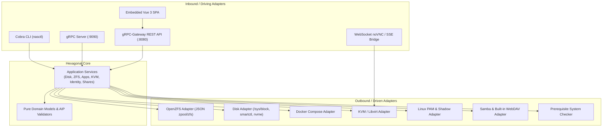

# NaN — Not Another NAS (`nasctl`)

[](https://github.com/sigxcpu/nas/actions/workflows/ci.yml)
[](https://goreportcard.com/report/github.com/sigxcpu/nas)
[](https://golang.org)
[](LICENSE)

**NaN** (**Not Another NAS**) is a modern, single-binary storage appliance daemon and CLI (`nasctl`) designed from first principles for Linux systems. It embeds a responsive, multi-theme **Vue 3 Single-Page Application (SPA)**, exposes standard **Google AIP-compliant REST and gRPC APIs**, and directly manages **OpenZFS**, **Docker Compose Applications (TrueNAS SCALE architecture)**, **KVM Virtual Machines with HTML5 noVNC**, **LXC Containers**, **CIFS / WebDAV shares**, and **Linux PAM Identity**.

---

## Table of Contents

- [Reason for Being](#reason-for-being)
- [Key Features & Capabilities](#key-features--capabilities)
  - [1. Unified Storage Subsystem](#1-unified-storage-subsystem)
  - [2. Docker Compose Applications (TrueNAS SCALE Architecture)](#2-docker-compose-applications-truenas-scale-architecture)
  - [3. KVM Hypervisor & HTML5 noVNC Console](#3-kvm-hypervisor--html5-novnc-console)
  - [4. LXC System Containers](#4-lxc-system-containers)
  - [5. Network File Sharing (CIFS & WebDAV)](#5-network-file-sharing-cifs--webdav)
  - [6. Linux PAM Identity & SSH Key Management](#6-linux-pam-identity--ssh-key-management)
  - [7. Dynamic Prerequisites & System Health Engine](#7-dynamic-prerequisites--system-health-engine)
- [Architecture & Design Principles](#architecture--design-principles)
- [Getting Started](#getting-started)
  - [Prerequisites](#prerequisites)
  - [Building from Source](#building-from-source)
  - [Running the Server Daemon](#running-the-server-daemon)
  - [CLI Client Usage](#cli-client-usage)
- [API & Protocols](#api--protocols)
- [License](#license)

---

## Reason for Being

Traditional Network-Attached Storage (NAS) operating systems (such as TrueNAS, Unraid, and OpenMediaVault) provide rich functionality but often introduce significant friction:

1. **Heavyweight Monolithic OS Bindings**: Many existing NAS appliances require installing a heavily customized Debian or FreeBSD distribution from a dedicated ISO, preventing deployment on standard Linux servers, lightweight Alpine systems, Arch Linux, or pre-existing distributions.
2. **Middleware & Database Bloat**: Legacy solutions rely on complex Python middleware layers (`middlewared`), background daemon meshes, and SQLite/PostgreSQL databases to maintain secondary state. This secondary state easily desynchronizes from the actual host state (e.g., if a user creates a dataset or modifies a container via the shell).
3. **Artificial User Abstraction**: Traditional appliances invent artificial `admin` accounts and proprietary user databases disconnected from the underlying operating system.
4. **Scattered Management Tooling**: Administrators often find themselves switching between Docker UIs (Portainer), storage consoles (Cockpit), VM managers (virt-manager/Proxmox), and Samba configs.

### The NaN Philosophy

- **Zero Middleware Bloat**: NaN compiles into a **single, static Go binary (`nasctl`)** that embeds its entire Vue 3 web interface via `//go:embed`. There are no external databases, no Python runtimes, and no background database migrations.
- **Truth from the Operating System**: The system is the source of truth. ZFS pools, datasets, block devices, containers, and Linux users are discovered live using native JSON output (`zpool list -j`, `zfs list -j`, `docker compose`), Linux `/sys` filesystem telemetry, and `/etc/passwd`.
- **Standardized API Contract**: Every operation adheres strictly to **Google AIP (API Improvement Proposals)** for resource naming (`zfsPools/{pool}/datasets/{dataset}`, `dockerApps/{app}`), standard pagination (AIP-158), custom methods (AIP-136), and FieldMask updates (AIP-134).
- **Pure Hexagonal Architecture**: Both the Go backend and Vue 3 frontend strictly decouple domain entities and use-case orchestrators from infrastructure protocols, ensuring full testability and maintainability.

---

## Key Features & Capabilities

```
+---------------------------------------------------------------------------------+
|                                   NaN UI                                        |
|  [Disks]  [Pools]  [Datasets]  [Volumes]  [Apps]  [KVM]  [LXC]  [Shares]  [Auth]|
+---------------------------------------------------------------------------------+
|                        Google AIP gRPC & REST Gateway                           |
|       /v1/disks · /v1/zfsPools · /v1/dockerApps · /v1/virtualMachines · ...     |
+---------------------------------------------------------------------------------+
|                          Linux Operating System Core                            |
|    /sys/block · OpenZFS · Docker Compose · libvirt · smartmontools · PAM        |
+---------------------------------------------------------------------------------+
```

### 1. Unified Storage Subsystem

The storage subsystem provides an appliance-grade management interface with an expandable sidebar tree:

- **Physical Disks (`/storage/disks`)**:
  - Direct hardware discovery through Linux `/sys/block/*`.
  - Real-time temperature monitoring in Celsius via `/sys/class/hwmon/*`.
  - S.M.A.R.T. health status and NVMe endurance tracking via `smartmontools` (`smartctl`) and `nvme-cli`.
  - Automated correlation of block devices and partitions with their **owning ZFS storage pool**.
  - Detailed sysfs hardware inspector (block sizes, serial, vendor, transport, firmware, partition table).
- **ZFS Storage Pools (`/storage/pools`)**:
  - Native OpenZFS JSON telemetry (`zpool list -j -p`, `zpool status -j`).
  - Redundancy topologies: Mirror (RAID-1), RAIDZ1 (single parity), RAIDZ2 (dual parity), and Stripe (RAID-0).
  - Prominent **"New Pool"** creation workflow.
  - Dual capacity usage and fragmentation metrics.
  - Background scrub task controls.
  - Dedicated VDEV tier attachment: Cache (L2ARC Read SSD), Log (SLOG/ZIL Write SSD), Special (Metadata), and Hot Spares.
  - Pool-level sync policy selection (`standard`, `always`, `disabled`) and autotrim.
- **ZFS Datasets (`/storage/datasets`)**:
  - Hierarchical POSIX filesystems with tree/flat display modes.
  - Prominent **"New Dataset"** button with child dataset creation.
  - Granular property tuning: compression (`lz4`, `zstd`, `gzip`, `off`), reservation bytes, quotas, sync modes, access times (`noatime`), and deduplication.
  - Point-in-time ZFS snapshot generation and restore trees.
- **ZFS Block Volumes / ZVols (`/storage/volumes`)**:
  - Raw block device emulation under `/dev/zvol/...` for virtual machine disks, databases, and iSCSI targets.
  - Prominent **"New Volume"** creation workflow.
  - Thin (sparse) vs. Thick (reserved) provisioning modes.
  - Live volume resizing and `volblocksize` optimization.

### 2. Docker Compose Applications (TrueNAS SCALE Architecture)

NaN adopts the TrueNAS SCALE Electric Eel philosophy where containers are organized exclusively as **Apps**:

- **Compose Descriptors as First-Class Citizens**: Each app is governed by a declarative `compose.yaml` describing multi-container stacks (e.g., Nextcloud Hub with application, PostgreSQL, and Redis cache).
- **TrueNAS SCALE Application Catalog Live Sync**:
  - Clones the official `truenas/apps` catalog locally with automatic periodic background synchronization and a manual "Sync Now" button.
  - Searchable catalog modal with category filters, app details, and 1-click installation into the visual editor.
- **ZFS Dataset Ownership for Containers**:
  - Docker engine and container state own a specific ZFS dataset (e.g., `tank/apps`).
  - Automatically provisions `{dataset}/appdata` (for bind mounts) and `{dataset}/docker` (for the Docker runtime).
- **Realtime 1-Second Telemetry**:
  - Live monitoring of CPU %, RAM usage, and **authoritative server-calculated network throughput rates (`net_rx_rate`, `net_tx_rate`)** in kB/s.
- **Visual Form & Raw YAML Bi-directional Editor**:
  - Form-based tabbed editor for services, host/container ports, environment variables (with `.env` bulk import), storage bind mounts (with path autocomplete), hardware passthrough, and resource limits.
  - Monospaced CodeMirror YAML editor with live synchronization.
- **Hybrid Path Selector**: Dual-mode input combining instant directory auto-completion with an interactive folder browser modal.

### 3. KVM Hypervisor & HTML5 noVNC Console

- **libvirt / QEMU-KVM Integration**: Create and manage hardware-accelerated Linux and Windows virtual machines.
- **Interactive Browser Console**: Built-in HTML5 Canvas RFB console proxy connecting directly to QEMU via a single-binary WebSocket bridge (`/ws/novnc/{vmName}`), complete with keyboard, mouse, and Ctrl+Alt+Del controls.
- **Storage Flexibility**: Back VMs using raw ZFS block volumes (ZVols) or qcow2 image files.

### 4. LXC System Containers

- Native Linux Container management using `lxc-ls`, `lxc-start`, `lxc-stop`, and `lxc-freeze`.
- Lightweight OS-level virtualization for network utilities, DNS servers, and isolated system workloads.

### 5. Network File Sharing (CIFS & WebDAV)

- **Samba / CIFS Sharing**: Manage SMB shares, valid user groups, guest access, and file creation masks.
- **Embedded WebDAV Server**: Single-binary built-in Go WebDAV engine accessible at `/dav/...` with zero external dependencies.

### 6. Linux PAM Identity & SSH Key Management

- Authentic Linux operating system security backed by `/etc/passwd`, `/etc/shadow`, and PAM.
- Manage Linux user accounts, primary/supplementary groups, shell selection, and account lock states.
- OpenSSH public key management with real-time validation and automatic synchronization to `~/.ssh/authorized_keys`.

### 7. Dynamic Prerequisites & System Health Engine

- The system continuously audits host binaries (`zpool`, `zfs`, `docker`, `virsh`, `qemu-system-x86_64`, `smartctl`, `nvme`, `lxc-ls`, `smbd`, `sshd`), shared libraries (`libzfs.so`, `libvirt.so`, `liblxc.so`), and kernel modules (`/dev/kvm`).
- Modules with missing host binaries are gracefully disabled in the UI with actionable installation hints (`apt install ...` or `pacman -S ...`), preventing crashes on minimal server installations.

---

## Architecture & Design Principles

NaN implements a **Strict Hexagonal (Ports & Adapters)** architecture:



---

## Getting Started

### Prerequisites

For a full-featured deployment on Linux, the following packages are recommended:

| Capability | Debian / Ubuntu Package | Arch Linux Package |
|---|---|---|
| **ZFS Storage** | `zfsutils-linux` | `zfs-utils` |
| **S.M.A.R.T. Health** | `smartmontools` | `smartmontools` |
| **NVMe Telemetry** | `nvme-cli` | `nvme-cli` |
| **Docker Apps** | `docker.io` `docker-compose-v2` | `docker` `docker-compose` |
| **KVM / Virtualization** | `qemu-system-x86` `libvirt-daemon-system` | `qemu-full` `libvirt` |
| **CIFS Sharing** | `samba` | `samba` |
| **OpenSSH** | `openssh-server` | `openssh` |

> [!NOTE]
> NaN starts cleanly even if some binaries are missing. Missing components will simply mark their respective modules as disabled on the Prerequisites status page.

### Building from Source

NaN requires **Go 1.24+** and **Node.js 20+**:

```bash
# Clone the repository
git clone https://github.com/sigxcpu/nas.git
cd nas

# (Optional) If regenerating Protobuf / gRPC definitions, ensure plugins and buf are installed:
go install google.golang.org/protobuf/cmd/protoc-gen-go@latest
go install google.golang.org/grpc/cmd/protoc-gen-go-grpc@latest
go install github.com/grpc-ecosystem/grpc-gateway/v2/protoc-gen-grpc-gateway@v2.32.0

# Build frontend and compile the single embedded binary
make build
```

This generates the standalone binary at `bin/nasctl`.

### Running the Server Daemon

Run `nasctl start` to start the embedded management interface:

```bash
# Run with root privileges to manage ZFS, disks, and system users
sudo ./bin/nasctl start \
  --http-port 8080 \
  --grpc-port 9090 \
  --jwt-secret "your-production-secret-token"
```

Open your browser and navigate to `http://localhost:8080`. Log in using your existing Linux system credentials (`username` and `password`).

### CLI Client Usage

The `nasctl` binary doubles as a full CLI client communicating with the running daemon over gRPC:

```bash
# Inspect storage disks and S.M.A.R.T. health
./bin/nasctl disk list
./bin/nasctl disk get nvme0n1

# Inspect ZFS storage pools
./bin/nasctl zfs pool list
./bin/nasctl zfs pool scrub tank

# Inspect Docker Compose applications
./bin/nasctl app list
./bin/nasctl app start nextcloud
./bin/nasctl app logs nextcloud --tail 50

# Inspect system prerequisites
./bin/nasctl prereq list
./bin/nasctl prereq check
```

---

## API & Protocols

NaN follows the **Google API Improvement Proposals (AIP)** convention:

- **Protobuf Schemas**: Maintained modularly in [`proto/nas/v1/`](proto/nas/v1/) (`service.proto` and per-entity proto files).
- **gRPC API**: Served on `:9090`.
- **REST / JSON Gateway**: Served on `:8080/v1/...` via `grpc-gateway`.
- **Authentication**: JWT Bearer token via `POST /v1/auth:login` and header `Authorization: Bearer <token>`.

### Common AIP Endpoints

| Resource | HTTP Method | AIP Path |
|---|---|---|
| **Disks** | `GET` | `/v1/disks` |
| **Disk Details** | `GET` | `/v1/disks/{disk_id}` |
| **ZFS Pools** | `GET`, `POST` | `/v1/zfsPools` |
| **Pool Scrub** | `POST` | `/v1/zfsPools/{pool}:scrub` |
| **ZFS Datasets** | `GET`, `POST` | `/v1/zfsPools/{pool}/datasets` |
| **ZFS Volumes** | `GET`, `POST` | `/v1/zfsPools/{pool}/volumes` |
| **Docker Apps** | `GET`, `POST` | `/v1/dockerApps` |
| **App Logs** | `GET` | `/v1/dockerApps/{app}:logs` |
| **KVM Machines** | `GET`, `POST` | `/v1/virtualMachines` |
| **Prerequisites** | `GET`, `POST` | `/v1/prerequisites`, `/v1/prerequisites:check` |

---

## License

Licensed under the Apache License, Version 2.0. See [LICENSE](LICENSE) for details.
