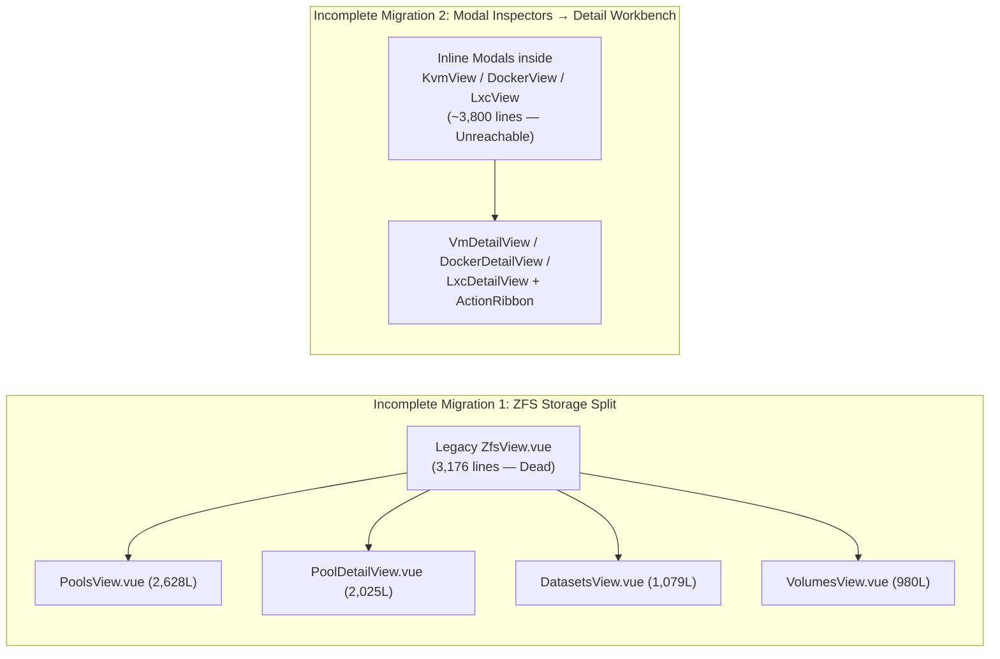
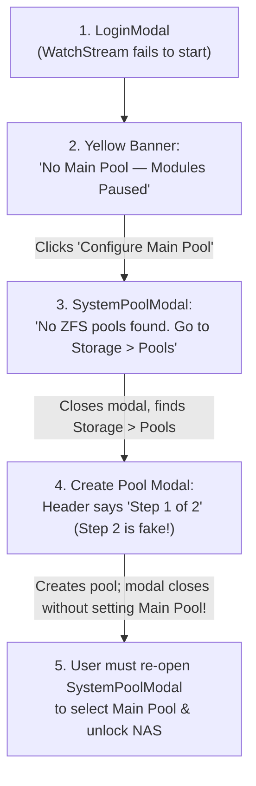

# NaN (`nasctl`) — Deep UX, UI & Workflow Analysis

**Audit Date:** November 2026 (re-audit: 2026-11-10, commit `eb520ac`, see [section 8](#8-re-audit-2026-11-10))  
**Scope:** Full-stack user experience, interface design, information architecture, and end-to-end operational workflows across:
- **Desktop Web Workbench** (`web/src/ui/`, `web/src/domain/`, `web/src/application/` — ~44,100 LOC across 68 Vue SFCs & TS modules)
- **Mobile Shell & PWA** (`web/src/ui/mobile/`, `web/public/sw.js`)
- **Native Android Client** (`android/app/src/main/`)
- **Built-in WebDAV Auto-Index UI & CLI** (`internal/adapters/outbound/share/autoindex.go`, `internal/cli/`)

---

## Table of Contents

1. [Executive Summary & Root-Cause Diagnosis](#1-executive-summary--root-cause-diagnosis)
2. [What NaN Gets Exceptionally Right](#2-what-nan-gets-exceptionally-right)
3. [Top P0 Critical UX, Safety & Workflow Blockers](#3-top-p0-critical-ux-safety--workflow-blockers)
4. [Domain-by-Domain UX & Workflow Deep Dive](#4-domain-by-domain-ux--workflow-deep-dive)
   - [4.1 Global Shell, Navigation, URL Routing & Async Feedback](#41-global-shell-navigation-url-routing--async-feedback)
   - [4.2 First-Boot Onboarding & System Administration](#42-first-boot-onboarding--system-administration)
   - [4.3 Storage & Network File Sharing](#43-storage--network-file-sharing)
   - [4.4 Compute Workloads: Docker Apps, KVM VMs & LXC Containers](#44-compute-workloads-docker-apps-kvm-vms--lxc-containers)
   - [4.5 Overview Dashboard & Telemetry Widgets](#45-overview-dashboard--telemetry-widgets)
   - [4.6 Mobile, Tablet (769px–1100px), PWA & Native Android](#46-mobile-tablet-769px1100px-pwa--native-android)
   - [4.7 Design System, Typography Scaling, Light Themes & Accessibility](#47-design-system-typography-scaling-light-themes--accessibility)
   - [4.8 Adjacent Touchpoints: WebDAV Browser & `nasctl` CLI](#48-adjacent-touchpoints-webdav-browser--nasctl-cli)
5. [Dead & Zombie UI Code Inventory (~8,500+ Lines)](#5-dead--zombie-ui-code-inventory-8500-lines)
6. [Prioritized UX & Frontend Architecture Roadmap](#6-prioritized-ux--frontend-architecture-roadmap)
7. [Execution & Verification Status](#7-execution--verification-status)
8. [Re-Audit 2026-11-10](#8-re-audit-2026-11-10)

---

## 1. Executive Summary & Root-Cause Diagnosis

NaN (`nasctl`) has a remarkably strong product vision: combining Proxmox VE's operational density (hierarchical resource tree, contextual action ribbon, live bottom task/audit dock, integrated noVNC and xterm.js consoles) with TrueNAS SCALE's storage and Docker Compose catalog ergonomics—all delivered from a zero-middleware single Go binary.

However, tracing real user journeys end-to-end reveals **8 Critical (P0) safety/workflow blockers**, **19 High-severity (P1) UX breaks**, and significant visual/interaction drift. Almost all of these issues trace back to **two half-completed UI migrations**:

1. **Incomplete Storage Split (`ZfsView.vue` → `PoolsView` / `PoolDetailView` / `DatasetsView` / `VolumesView`)**:
   - Left **4,166 lines of dead/orphaned code** (`ZfsView.vue`, `DatasetHierarchyTree.vue`, `ZfsPoolGauge.vue`), duplicated VDEV topology/dataset/volume logic in three places with **diverging RAIDZ capacity math and API calls**, and dropped `recordsize`, `readonly`, and per-disk ZFS read/write/checksum error counters.
2. **Incomplete Workbench Migration (Inspector Modals → Master-Detail Views + `ActionRibbon`)**:
   - Clicking rows in `KvmView`, `DockerView`, and `LxcView` now navigates to Detail Views while ~3,800 lines of old Inspector/Edit modals sit unreachable in those files. Crucially, **key lifecycle features in those old modals were never ported to the new Detail Views**—leaving users unable to eject/swap KVM installer ISOs post-install, unable to edit existing VM disks/NICs, and unable to purge Docker volumes when deleting an app from `ActionRibbon`.

---

## 2. What NaN Gets Exceptionally Right

Before addressing defects, these high-value UX patterns should be preserved as the baseline standard across the product:

1. **OS-as-Source-of-Truth Speed & Live Streaming**: Combining `localStorage` state hydration (`store.ts:144-175`) with server-pushed resource watch deltas (`resources:watch`) eliminates traditional NAS middleware lag.
2. **Hardware S.M.A.R.T. Inspector (`DisksView.vue:356-565`)**: Clean 3-tab drawer normalizing NVMe health logs and SATA S.M.A.R.T. attributes, humanized power-on hours, critical-attribute highlighting, and OS boot-disk badges.
3. **Interactive VDEV Topology Designer (`PoolsView.vue:1311-1688`)**: Combines drag-and-drop with accessible `+ Add` click menus, `ALL/NVME/SSD/HDD` media filters, and 1-click `"Fill Remaining"` auto-population.
4. **Mental-Model Presets for Complex Protocols**:
   - **Samba Access Presets (`SharesView.vue:653-687`)**: Translates cryptic `smb.conf` directives into three clear choices (*Restricted Users/Groups*, *Public Guest Read-Write*, *Guest Read-Only + Auth Write*).
   - **Multi-OS WebDAV Connect Guide (`SharesView.vue:1374-1513`)**: OS-tabbed copyable commands for Windows (`net use` + Explorer), macOS (`Cmd+K`), Linux (`davfs2`/GNOME/KDE), iOS, and Android.
   - **Windows VM Auto-Tuning (`KvmView.vue:503-527`)**: Selecting Windows 10/11 automatically switches to `ovmf` (UEFI), `q35`, `TPM 2.0`, Secure Boot, and prompts for a `virtio-win` driver ISO.
5. **Best-in-Class HTML5 `VncConsole.vue` (`1-1010`)**: Scaling modes (`Fit`, `100%–200%`), Linux TTY shortcut pills (`Ctrl+Alt+F1..F3`), host-to-guest text paste bar, ACPI power explanations, and standalone pop-out window support (`/vnc-console`).
6. **Zero-Touch LAN HTTPS Root CA (`internal/certutil/certutil.go`, `/ca.crt`)**: Auto-generating a 10-year Root CA + SAN server certificate and serving `/ca.crt` directly addresses homelab self-signed TLS pain on iOS/Android/macOS.
7. **ANSI-Aware `LogViewer.vue` & 6 Theme Palettes (`styles.css:10-603`)**: Safe SGR color rendering, line filtering, wrap toggle, plain-text copy (`stripAnsi`), and thoughtfully curated dark/light developer themes.

---

## 3. Top P0 Critical UX, Safety & Workflow Blockers

| ID | Surface | Severity | Summary of Defect & User Impact | Exact Code Location |
| :--- | :--- | :---: | :--- | :--- |
| **P0-1** | Docker & LXC Terminals | **CRITICAL** | Clicking **"Pop-out"** on an LXC or Docker container terminal opens `/terminal?lxc=<id>` or `/terminal?container=<id>`. Neither query parameter is parsed anywhere: `App.vue` intercepts `tab === 'terminal'`, strips query params via `navigateTo('overview', true)`, and opens **`HostTerminalModal` (root host shell)** over the dashboard. An admin running destructive commands (`rm -rf`, `reboot`) in what they believe is an isolated container window executes them **as root on the NAS host**. | `web/src/ui/App.vue:264-267`, `ActionRibbon.vue:313-322`, `DockerDetailView.vue:245-254`, `LxcDetailView.vue:230-238` |
| **P0-2** | Docker Form ↔ YAML Editor | **CRITICAL** | 1) **Security leak**: `127.0.0.1:8080:80` drops `parts[0]` on Form load and saves as `8080:80` (`0.0.0.0`). 2) **Silent stack wipe**: `composeYamlToForm` catches YAML syntax errors and returns a blank `nginx` service—switching from YAML to Form with a 1-char typo **erases the entire multi-service stack**. 3) **Silent field stripping**: Round-tripping destroys all custom `labels` (Traefik/Homepage), `healthcheck`, `cap_add`, `user`, `shm_size`, `env_file`, and comments. 4) **Forced OOM limits**: Watcher forces `512m` RAM and `1.0` CPU limits on every service with no `"Unlimited"` option. | `web/src/domain/composeModel.ts:275-282, 384-387, 525-527, 720-867`, `ComposeFormEditor.vue:95-115, 147-157, 256-270, 1458-1495` |
| **P0-3** | ZFS Nested Datasets & ZVols | **CRITICAL** | Clicking `+` (*Add Child Dataset*) on `tank/media` or typing `appdata/postgres` or `vms/ubuntu` (literally suggested in input placeholders!) passes `"media/movies"` to `isValidResourceId()`, whose regex `/^[a-zA-Z0-9][a-zA-Z0-9._-]{0,62}$/` **forbids `/`**. Nested dataset and nested ZVol creation is **100% broken across the entire UI**. | `web/src/domain/models.ts:974-978`, `application/services.ts:256-258, 307-309`, `DatasetsView.vue:372, 710`, `PoolDetailView.vue:1536`, `VolumesView.vue:719` |
| **P0-4** | Mobile → Desktop Switch | **CRITICAL** | Tapping *"Switch to Desktop Layout"* on mobile saves `nas_device_view_mode = 'desktop'`, unmounts `MobileShell.vue`, and mounts Desktop `App.vue`—which has **zero button to return to Mobile view**, while `@media (max-width: 768px) .hide-mobile` hides Sign Out, Host Shell, Updates, and Sidebar! Restarting the Android app fails to recover because `MainActivity.kt` writes to the wrong key (`device_ui_mode_override`). | `web/src/ui/composables/useDevice.ts:5, 46-52`, `App.vue:361-465`, `styles.css:1713-1715`, `MainActivity.kt:189` |
| **P0-5** | Auth & Live Stream Lifecycle | **CRITICAL** | 1) **Web fresh login**: `LoginModal.vue` calls `startEventStream()` without `startWatchStream()`—fresh logins have **frozen telemetry, CPU, and network charts** until manual F5 reload. 2) **Android token overwrite loop**: `MainActivity.kt` injects `profile.token` asynchronously (racing `AipClient` startup), ignores web Sign Out, and **overwrites freshly re-authenticated JWTs back to expired `profile.token`** on every navigation. | `web/src/ui/components/LoginModal.vue:20-21`, `App.vue:313-315`, `aipClient.ts:51-62`, `MainActivity.kt:145-202`, `LoginActivity.kt:38-42` |
| **P0-6** | Storage & VM Destructive Safety | **CRITICAL** | 1) **Zero blast-radius checks**: Deleting a Pool, Dataset, or ZVol never checks `nasState` for active VMs, Docker apps, LXC rootfs, SMB/WebDAV shares, or `.nas-system` Main Pool status. 2) **Silent data-loss footguns**: Casual checkboxes/options for ZFS `dedup=on` (RAM exhaustion), `sync=disabled` (data loss), ZVol shrinking (filesystem truncation), and instant unconfirmed `Force Stop` (`mdiStop`) next to `Shutdown` in `ActionRibbon`. | `PoolsView.vue:515-529`, `DatasetsView.vue:446-462, 826`, `VolumesView.vue:345-390`, `ActionRibbon.vue:163-178, 605-629` |
| **P0-7** | Samba Security & Share State | **CRITICAL** | `SharesView` hardcodes `forceCreateMode: '0664'` and `forceDirectoryMode: '0775'` with no UI fields while exposing `createMask`. Because Samba ORs `force create mode` *after* `create mask`, setting `createMask = 0600` still forces **world-readable (`0664`) files**! Additionally, `enabled` has no UI toggle anywhere—shares cannot be disabled/re-enabled. | `web/src/ui/views/SharesView.vue:121-127, 145-152, 168, 232, 730-737` |
| **P0-8** | OTA System Update Safety | **CRITICAL** | `SystemUpdateModal` renders `marked.parse(releaseNotes)` via raw `v-html` without `DOMPurify` (stored/MITM XSS in a root-capable UI), applies updates without warning about running VMs/scrubs, and locks the screen in an **un-closable infinite 2-second polling loop** if daemon restart fails. | `web/src/ui/components/SystemUpdateModal.vue:29-32, 54-109, 234` |

---

## 4. Domain-by-Domain UX & Workflow Deep Dive

### 4.1 Global Shell, Navigation, URL Routing & Async Feedback

#### A. Broken Deep Linking, Browser History & Route Hijacking (`router.ts`, `App.vue`, `store.ts`)
- **Resources & Subtabs Missing from URLs**: `TAB_ROUTES` (`router.ts:4-22`) only encodes top-level modules (`/apps`, `/kvm`, `/lxc`, `/storage/pools`). Selecting VM `win11` or Pool `tank` only mutates `nasState.selectedResourceId` (`store.ts:307-322`) without pushing a URL or history entry.
  - **Consequence 1 (Broken Back Button)**: User is on `/apps` → clicks `jellyfin` (`DockerDetailView` opens) → clicks Browser **Back** expecting to return to `/apps` list → browser jumps completely out of Apps to whatever module they visited *before* `/apps`!
  - **Consequence 2 (No Deep Links)**: Administrators cannot bookmark or share links to `/kvm/win11/console`, `/apps/immich/logs`, or `/storage/pools/tank/topology`.
- **`localStorage` Route Hijacking on Page Load (`App.vue:321-350`)**: `onMounted` reads `nan_last_active_resource` from `localStorage` and calls `navigateTo('kvm' | 'lxc' | 'docker' | ...)` without checking whether the user explicitly requested `/overview`, `/cron`, or `/shares` in the address bar (it only exempts `/vnc-console` and `/terminal`). Typing `https://nas:8080/cron` and pressing Enter redirects you to `/kvm` if a VM was your last selected resource!

#### B. `ResourceTree` ↔ `ActionRibbon` Cognitive Friction (`ResourceTree.vue`, `ActionRibbon.vue`)
- **Collapsed-by-Default Everything**: `ResourceTree.vue:36-43` starts all 6 sidebar sections collapsed (`false`), and both `DatasetsView.vue:37` and `VolumesView.vue:34` start `expandedPaths` empty (`new Set()`). Opening *Datasets* or *Volumes* in default Tree mode shows **only collapsed pool rows**, making a populated NAS appear to have zero datasets until the user clicks tiny 16px chevrons.
- **Disappearing Storage Sub-Navigation**: Global *Datasets* and *Volumes* do **not** exist in `ResourceTree.vue:200-269`—they only appear in `ActionRibbon.vue:993-1030` when *no individual pool is selected*. As soon as a user clicks `tank` in `ResourceTree`, those global tabs vanish and are replaced by `PoolDetailView`'s stripped-down *Datasets*/*Volumes* subtabs (which lack Edit, Resize, Snapshot, Quota, and Tree view!).
- **Broken `"ISOs & Templates"` Node (`ResourceTree.vue:260-267`)**: Clicking *Storage → ISOs & Templates* calls `handleSelect('node:isos', 'kvm')`, which opens `KvmView` on the **Virtual Machines** tab (`KvmView.vue:77-98` ignores `node:isos`), while LXC templates actually live in `LxcView`!
- **Icon-Only Mystery Meat in `ActionRibbon.vue:1058-1334`**: All primary lifecycle and destructive actions in the top-right ribbon are `28×28px` icon-only buttons with no visible text labels:
  - On KVM (`1094-1113`), `mdiPower` (*ACPI Shutdown*) sits 6px away from `mdiStop` (*Instant Force Power Off — no confirmation*), inviting catastrophic misclicks.
  - On Storage Pools (`1247-1264`), `Export Pool` sits 6px away from red `Destroy Pool Permanently`.

#### C. Fragmented Async Feedback, Lost Uploads & Toast Flaws (`TaskConsoleDock.vue`, `store.ts`, `styles.css`)
- **Navigating Away Destroys Multi-GB Upload Progress**: ISO uploads (`KvmView.vue:1103-1132`) and LXC template uploads (`LxcView.vue:827-856`) store XHR state (`isUploadingIso`, `isoUploadProgress`) in local component refs. Clicking another sidebar tab during a 5 GB Windows ISO upload unmounts `KvmView` and **loses all visible upload state**, with zero entry in `TaskConsoleDock`!
- **Half-Wired `TaskConsoleDock`**: Detail views and `ActionRibbon` wrap actions in `runTrackedTask()`, **but `PoolsView`, `KvmView` (VM creation), `LxcView` (5-minute catalog deployments!), `IdentityView`, and `CronJobsView` never call `runTrackedTask()`**—so the heaviest tasks on the appliance never appear in the bottom Task & Audit Console.
- **Toast Notification Defects**:
  - `.toast-warning` is **missing from `styles.css:1558-1569`**, even though `notify('warning', ...)` is used throughout `store.ts` and `ActionRibbon.vue`.
  - Toasts auto-dismiss after `4200ms` (`store.ts:302`) with **no close button, no hover-to-pause, and no copy button**—long ZFS/Docker/libvirt stderr messages vanish mid-read.

---

### 4.2 First-Boot Onboarding & System Administration

#### A. Fragmented Day-0 Onboarding & Fake 2-Step Pool Wizard
Today, a user booting NaN on a fresh Linux server faces a disjointed 5-screen scavenger hunt:

- **Fake 2-Step Stepper (`PoolsView.vue:1323, 1328-1331`)**: The Create Pool modal renders step circles `1` and `2` (*"Step 1 of 2 — Configure pool identity..."* / `title="Step 2: Initialization"`), **but Step 2 was never implemented**—submitting Step 1 creates the pool and immediately closes the modal, leaving the new pool unselected as Main Pool!
- **Four Divergent "Set Main Pool" Code Paths**:
  - `PoolsView.vue:551` and `SystemPoolModal.vue:91` call `services.system.selectMainPool(name, true)` (initializes `.nas-system` and restores config).
  - `ActionRibbon.vue:564` and `PoolDetailView.vue:135` call `services.system.updateSystemConfig({ mainPool: name })` **with zero confirmation**, bypassing `selectMainPool` initialization!
- **Prerequisites & System Details Friction (`PrerequisitesModal.vue`, `PrerequisitesView.vue`, `SystemDetailsModal.vue`)**:
  - `PrerequisitesView.vue` (483L) and `PrerequisitesModal.vue` (469L) are 95% duplicated, and `App.vue:261-263` redirects `activeTab === 'prerequisites'` to `overview`, making `<PrerequisitesView>` (`App.vue:597`) unreachable on desktop.
  - Missing package remediation (`PrerequisitesModal.vue:208-233`) asks users to copy shell commands without offering an **`"Open Host Terminal"`** button right beside it, and `generateFallbackScript()` (`126-141`) hardcodes `apt-get` even on Arch/Fedora/Alpine hosts.
  - `SystemDetailsModal.vue:341, 360-371` hardcodes fallback version `'v1.6.8'` and renders a static `['ZFS', 'KVM', 'Docker', 'LXC', 'CIFS', 'WebDAV']` list as **"Active Modules"** even when those binaries are uninstalled!

#### B. `IdentityView.vue` — Linux PAM vs. Samba Password Trap & Self-Lockout
- **Unexplained Dual-Password Model & Edit Desync (`IdentityView.vue:185-186, 253-260, 455-461, 541-577`)**:
  - When **creating** a user, leaving *Samba Password* blank copies the Linux password (`line 186`). When **editing** a user (`lines 253-260`), changing *New Password* while leaving *New Samba Password* blank updates **only** `/etc/shadow`, silently leaving Samba on the old password!
  - Checking `SMB Access` (`line 569`) on an existing user without entering a Samba password displays `SMB: ON` (`line 673`) while SMB logins fail because no NT-hash exists.
- **Admin Self-Lockout / Self-Delete (`lines 249-250, 271-296, 572-576`)**: Nothing prevents the currently logged-in user (`nasState.currentUser`) from locking their own account, revoking their own admin group, or deleting themselves (with `Remove home directory` checked by default at `line 281`!).
- **Arbitrary `10000` UID/GID Ceiling (`lines 19, 35, 158, 303`)**: Standard Linux `UID_MAX` is `60000` (and container/LDAP UIDs often exceed `10000`); capping non-system accounts at `10000` hides valid users and blocks valid UIDs.
- **Invisible Primary Group Members (`lines 814-824`)**: The Groups table only lists supplementary `/etc/group` members, so primary groups appear to have `"No members"`.

#### C. `CronJobsView.vue` — Deceptive Schedule Previews & Container-Only Surprises
- **False `humanizeCron()` Previews (`lines 99-111, 889-912`)**: `humanizeCron` matches only 5 exact strings plus `min.startsWith('*/')`:
  - Typing `*/5 9-17 * * 1-5` falsely previews **`"Every 5 minutes"`**, ignoring business-hour and weekday fields!
  - Typing `0 2 * * *` previews raw `0 2 * * *`, and editing the expression never switches `Schedule Preset` (`line 892`) to `'custom'`.
- **Pre-Filled Production Paths & Missing `command` Field (`lines 308, 372-383, 452, 914-942`)**:
  - Clicking *New Scheduled Task* pre-fills `rclone/rclone:1` and two real host bind mounts (`/data/library` and `/mnt/tank/.nas-system/rclone`) as live form state instead of offering starter templates.
  - `form.commandStr` (`line 308, 452`) and `form.restartPolicy` exist in TypeScript state and API submission, **but have zero input fields in the template**—users cannot override a Docker image's entrypoint!
  - Every cron job requires Docker, yet `/cron` is not gated on Docker availability in `App.vue:273-293`.
- **Missing Run Controls**: No **Abort/Stop** button while a job is `RUNNING` (`timeout` defaults to `Unlimited`), logs only show the single latest run (no history), and pause/resume uses confusing `mdiClockOutline` / `mdiAlertCircle` icons (`lines 743-747`).

---

### 4.3 Storage & Network File Sharing

#### A. Bare Disks → ZFS Pools → Scrubs
- **No Disk Wipe / Label Clear (`DisksView.vue`, `PoolsView.vue:181-190`)**: `DisksView` is completely read-only. Repurposed drives with old GPT partitions, mdadm RAID superblocks, or foreign ZFS labels cannot be wiped from the UI, while `unassignedDisks` in `PoolsView` includes disks with existing partitions (`d.partitions.length > 0`) without warning.
- **Broken Cross-View Links**:
  - Clicking an owning pool badge in `DisksView.vue:133-137` (`goToPool`) sets `selectedPoolName` instead of `selectResource('pool:' + clean)`, failing to open `PoolDetailView`.
  - Clicking `"Datasets"` on a pool card (`PoolsView.vue:900-903`) sets `nasState.selectedPoolName`, which `DatasetsView.vue:34` (`selectedPool = ref('all')`) completely ignores!
- **Misleading Health & Scrub Indicators (`PoolDetailView.vue`)**:
  - Lines `896` and `1052` **hardcode `ONLINE`** for every drive in `poolDisks`, even when a drive or pool is `DEGRADED` or `FAULTED`, and drop per-drive Read/Write/Checksum error counts!
  - Line `861` renders a green `mdiCheckCircle` beside `lastScrubStatus` even when a scrub failed, repaired errors, or was canceled, and there is **no Pause/Stop Scrub button or live scrub % progress bar**.
- **Copy-Paste Confirmation Bug (`ActionRibbon.vue:581`, `PoolDetailView.vue:151`)**: Calling `confirmDelete({ kind: 'Export ZFS Pool', name })` produces title **"Delete Export ZFS Pool"** and message *"This will permanently delete export zfs pool 'tank'"* for a safe, non-destructive `zpool export`!
- **Diverging RAIDZ Expansion Math & Missing `ashift` (`PoolsView.vue:747-788` vs `PoolDetailView.vue:469-490`)**:
  - `PoolsView` expansion uses `raidz1 && count >= 2` (off-by-one bug; RAIDZ1 requires >= 3 disks), whereas `PoolDetailView` uses `>= 3`.
  - Neither Pool Creation nor VDEV Expansion exposes **`ashift` (`9`/`12`/`13`)** or warns when mixing NVMe/SSD/HDD or mismatched drive capacities in the same VDEV.

#### B. ZFS Datasets, ZVols & "Write-Only" Snapshots
- **Write-Only Snapshots (`DatasetsView.vue:693-723, 920-950`, `ports/outbound.ts:84-98`)**: Users can *create* a dataset snapshot and see `snapshotsCount`, **but there is zero UI (or frontend port) to list snapshots, delete old snapshots reclaiming space, roll back a dataset, or clone a snapshot**. ZVols (`VolumesView.vue`) cannot even take snapshots.
- **Lost Properties & Divergent Subtabs**: `recordsize` (`16K`–`1M`) and `readonly` were lost when `ZfsView.vue` was abandoned. Meanwhile, `PoolDetailView`'s *Datasets* and *Volumes* subtabs (`909-1020`) are severely degraded clones of `DatasetsView`/`VolumesView` (missing Edit, Resize, Snapshot, Quota, Reservation, Sync, Dedup, and passing `'16384'` instead of `'16k'` for `volblocksize` at `line 720`).

#### C. Network Shares (`SharesView.vue`) & The POSIX Permission Chasm
- **No NFSv3/NFSv4 Support**: For a Linux hypervisor/NAS appliance hosting KVM VMs and LXC containers, **NFS exports are completely missing** (only SMB and WebDAV exist).
- **Zero Dataset ↔ Share Integration & Root-FS Fill Risk**:
  - Orphaning `DatasetHierarchyTree.vue` (773 lines, unused!) forced `SharesView.vue:630` to use `PathSelector` starting at `/mnt`, with `cifsForm.path` defaulting to hardcoded `'/mnt/tank/media'` (`line 107`).
  - Typing a path like `/mnt/typo/movies` in `PathSelector` creates a folder **on the root OS boot disk** with zero warning that it is not backed by any ZFS dataset!
  - Neither `DatasetsView` nor `SharesView` cross-links datasets to active shares.
- **The Samba vs. POSIX `0755` Trap**: Adding `@family` to `Valid Write Users/Groups` in `SharesView` updates `smb.conf`, **but new ZFS datasets are owned by `root:root` (`0755`)**. Without a UI to set dataset owner/group/ACL mode (`chown`/`chmod`), non-root SMB users hit `NT_STATUS_ACCESS_DENIED` on write until an admin SSHes into the host!
- **Unchecked `User.smbEnabled` & Hardcoded Share URLs**:
  - `UserGroupSelector.vue:30` (`allowCustom: true`) accepts nonexistent usernames without warning and never badges users who lack an SMB password (`!user.smbEnabled`).
  - `SharesView.vue:950` hardcodes `//nas/{{ s.shareName }}` instead of the appliance's real hostname/IP (and offers no copy button or SMB Connect Guide), while WebDAV (`line 198`) hardcodes `http://${host}:8081`.
  - `SharesView.vue:546-569` renders a duplicate `SMB / CIFS | WebDAV` pill bar directly underneath `ActionRibbon`'s identical `SMB / CIFS | WebDAV` tab bar, and inline Edit forms (`754-886`, `1192-1277`) open off-screen above long share tables without scrolling.

---

### 4.4 Compute Workloads: Docker Apps, KVM VMs & LXC Containers

#### A. Cross-Workload UX Consistency Matrix

| Dimension | Docker Apps | KVM Virtual Machines | LXC System Containers | Consistency & UX Gap |
| :--- | :--- | :--- | :--- | :--- |
| **Create Pattern** | Modal Wizard / Fullscreen Editor | Modal Wizard (+ 3 stacked child modals!) | **Inline expanding form** above table | LXC breaks modal pattern; KVM nests modals 2-deep. |
| **Console / Shell** | Embedded xterm (`DockerDetailView`) | Embedded + Standalone noVNC (`VncConsole`) | Embedded xterm (`LxcDetailView`) | **Pop-out broken on Docker & LXC** (opens root Host Shell); `EmbeddedTerminal` lacks Fullscreen button. |
| **Disk / Quota Sizing** | Unbounded host bind mounts (3 conflicting base paths!) | Explicit ZVol / qcow2 GiB sizing | **Zero rootfs quota / disk limit** | Any LXC container can fill 100% of the main ZFS pool. |
| **Host Mount Picker** | `PathSelector` modal/autocomplete | ISO `<select>` (**no CD-ROM edit/eject post-create!**) | **Raw `<input>` text fields** (`window.confirm` on delete) | Reuse `PathSelector` in LXC; restore CD-ROM controls in `VmDetailView`. |
| **Snapshots & Clones** | Upgrade-time ZFS snapshot opt-in only | Full `Snapshots` subtab + Ribbon `Clone` | **None** | ZFS-backed LXC containers lack snapshot, rollback, and clone UI. |
| **Web Portal Link** | Auto-detected `Open Web UI` button | N/A (VNC) | Catalog shows `defaultPort`, **then discards it** | Persist LXC `defaultPort` to offer 1-click `Open Web UI` once DHCP resolves. |
| **Detail Telemetry** | CPU%, RAM, 1s Net RX/TX + totals | CPU%, Host RSS vs Allocated RAM | CPU% + RAM Used (**omits Net RX/TX & RAM Limit shown in List!**) | `LxcDetailView` shows *less* telemetry than `LxcView`'s table row! |

#### B. Docker Compose & TrueNAS Catalog Friction
- **Blank Mobile Screen in `CatalogQuestionWizard.vue:107, 923-931`**: `showLivePreview` defaults to `true`, while `@media (max-width: 900px)` sets `.wizard-body.with-preview .wizard-form-pane { display: none !important }`—opening any Catalog app on a tablet/phone hides 100% of the configuration form behind the YAML preview!
- **Single-Instance Lock & Misleading Wizard Labels (`CatalogQuestionWizard.vue:180-184, 575`)**: Users cannot edit the App/Instance ID in the Catalog Wizard (preventing multiple Postgres/Redis/WordPress stacks), required schema fields aren't validated before deploy, and `"Skip Wizard & Open Raw YAML"` actually opens **Form** mode (`DockerView.vue:406-422`).
- **Three Conflicting Appdata Path Conventions**:
  1. `DockerView.vue:2452` (Engine Config): `/mnt/<dataset>/appdata`
  2. `ComposeFormEditor.vue:199`: `/mnt/<mainPool>/apps/<appId>/<subpath>` (ignores `dockerConfig.dataset`!)
  3. `CatalogQuestionWizard.vue:192`: `/mnt/<mainPool>/apps/<appId>/<leaf>` (also ignores `dockerConfig.dataset`!)
- **Regressions in `ActionRibbon.vue:487-529`**: Deleting an app from `ActionRibbon` hardcodes `deleteApp(name, false)` (omitting the `"Purge persistent volumes (-v)"` checkbox from unreachable `DockerView.vue:843`), and clicking `Upgrade` runs immediately with **zero confirmation or version diff**.

#### C. KVM Virtual Machine Regressions & Creation Friction
- **Post-Install CD-ROM Dead End (`VmDetailView.vue:901-914`)**: `VmDetailView` renders `—` in the Actions column for all CD-ROM devices. After installing Windows or Ubuntu, **there is no way in the UI to eject the installer ISO or mount `virtio-win.iso`** (even though working `openChangeCdromModal` / `handleEjectCdrom` code sits unreachable at `KvmView.vue:859-888, 2862-2926`!).
- **Lost Hardware Controls in `VmDetailView.vue:714-934, 1081-1094`**: Cannot edit existing disk cache/bus or NIC VLAN/MAC; Add NIC uses a plain `<input placeholder="br0">` instead of a host bridge `<select>` and omits a `vlanTag` input; Hardware Configuration submits `tpmVersion` and `hugepages` (`lines 310, 313`) without rendering inputs for either!
- **Silent Unconditional Cloud-Init (`KvmView.vue:290-295, 1728-1733`)**: Even when the *Cloud-Init* section is left collapsed and untouched, `handleWizardSubmit` attaches `cloudInit: { user: 'admin', ipConfig: 'dhcp' }` to every new VM!
- **Outdated Firmware Defaults & Missing Post-Create Boot**: Modern Linux OS presets default to legacy `seabios` instead of `ovmf` (UEFI), the Wizard allows enabling `Secure Boot` while `SeaBIOS` is selected (`line 3968`), host network interfaces (`br0`, `eno1`, `virbr0`) lack LAN Bridge vs. NAT explanations, and there is no `"Start VM & Open Console after creation"` checkbox.

#### D. LXC Container Creation & Lifecycle Gaps
- **Hardcoded 4-Distro Dropdown Breaks Catalog (`LxcView.vue:1015-1021` vs `894-899`)**: `form.distribution` only lists `debian`, `ubuntu`, `alpine`, `archlinux`—selecting a `fedora`, `rockylinux`, `almalinux`, or `centos` template renders a blank `<select>`!
- **Missing Nesting / TUN & Unsafe `Unprivileged` Edit (`LxcDetailView.vue:639-654`)**: LXC lacks **Nesting** (`lxc.apparmor` / `features: nesting=1`, required for Docker-in-LXC and many TurnKey/Community Scripts) and `/dev/net/tun` passthrough, while allowing users to toggle `Unprivileged` on an already-created container without warning that rootfs UID `0` vs `100000` ownership will break boot.

---

### 4.5 Overview Dashboard & Telemetry Widgets

1. **Grid Customization Ergonomics (`OverviewView.vue`, `dashboardConfig.ts`, `AddWidgetModal.vue`)**:
   - **Broken on Touchscreens**: Uses HTML5 `draggable="true"` (`OverviewView.vue:209-238, 292`), which does not work on iOS/iPadOS/Android touchscreens; `:draggable="isEditing"` on the entire `.widget-wrapper` also hijacks clicks anywhere inside cards rather than restricting drag initiation to `.drag-handle`.
   - **Grid Holes & Viewport Media Queries**: `.dashboard-bento-grid` (`line 458`) omits `grid-auto-flow: dense`, leaving 4-column gaps when `2/3` (`8`) and `1/2` (`6`) cards meet. Inside widgets (`WidgetPools.vue:460`, `WidgetKpis.vue:184`), responsive rules use `@media (max-width: ...)` instead of CSS `@container` queries—so narrow `col-span-3`/`col-span-4` cards overflow on 1440p monitors!
   - **Silent Widget Deletion on Migration (`dashboardConfig.ts:154-156`)**: Migrating layouts to `v3` forcibly strips `cpu`, `memory`, and `system` widgets even if the user explicitly added them, while `AddWidgetModal.vue:135-146` allows adding infinite duplicate copies of singleton widgets (`WidgetKpis`, `WidgetCpu`).
   - **Redundant Composite Widget**: `WidgetWorkloads.vue` (`1-29`) simply wraps `<WidgetVms /><WidgetApps /><WidgetShares />`, duplicating standalone widgets without allowing individual resizing.
2. **Concrete Widget Data & Navigation Bugs**:
   - **`WidgetMemory.vue:28 vs 145` (`0 B` Bug)**: Donut chart computes `servicesBytes = mem.servicesBytes || Math.max(0, usedBytes - zfsArcBytes)`, while the footer card at line `145` renders `formatBytes(telemetry?.memory?.servicesBytes || 0)` without the fallback—displaying **`0 B`** right underneath a `14 GiB` chart slice!
   - **Dropped Click Context (`WidgetApps.vue:91,118`, `WidgetVms.vue:53`, `WidgetPools.vue`)**: Clicking a specific app, container, VM, or pool navigates to the top-level list without calling `selectResource(...)`, forcing the user to find and click the same item a second time.
   - **Double Telemetry Polling & Fake History Plateau (`OverviewView.vue:84-86`, `store.ts:658-669`)**: `OverviewView` runs a `2000ms` `refreshTelemetry()` interval simultaneously with `startWatchStream()`'s live `telemetry` push, and `recordNetworkTrafficSample` pre-fills all 30 historical points with the first instantaneous reading (drawing a fake flat 30s line on load).
   - **False/Missing Status Pills**: `WidgetShares.vue:69` hardcodes `//nas/` and renders disabled shares identically to active ones; `WidgetDisks.vue:69` checks `smartStatus !== 'PASSED'` case-sensitively and shows blank space when healthy; `WidgetPools.vue:204` hides the `ONLINE` badge when healthy.

---

### 4.6 Mobile, Tablet (`769px–1100px`), PWA & Native Android

#### A. Mobile Feature Reachability & Dead Routes (`MobileShell.vue`, `MobileKvmView.vue`, `MobileOverview.vue`)
- **Shadowed Dead Route Blocks All Dataset & Snapshot Management (`MobileShell.vue:53-60, 111, 131`)**: `isStorage` includes `'storage-datasets'`, so `<MobileStorageView v-else-if="isStorage">` (`line 111`) intercepts navigation before `<DatasetsView v-else-if="activeTab === 'storage-datasets'">` (`line 131`) can ever render—leaving mobile users with a read-only property sheet and **zero access to Dataset CRUD or ZFS Snapshots**! Meanwhile, `VolumesView` (`line 132`) has no link in `MobileNavDrawer.vue`.
- **`/lxc` Opens VMs Tab (`MobileKvmView.vue:25`)**: `activeTab` is hardcoded to `ref<'vms' | 'lxc'>('vms')` without watching `nasState.activeTab === 'lxc'`, so tapping *LXC* in `MobileNavDrawer` lands on Virtual Machines.
- **False Health Copy & Missing Task Log (`MobileOverview.vue:151, 309`)**: `MobileOverview` displays *"All Core Systems Operational"* even when no Main Pool is configured, hardcodes *"All reporting OK"* on the Disks card even when S.M.A.R.T. fails, shows a permanent green dot on the `Apps` bottom tab whenever >= 1 app exists (`MobileShell.vue:157`), places a red `mdiPower` icon (`line 96`) on a sheet with zero NAS Shutdown/Reboot actions, and provides **no mobile access to `TaskConsoleDock`**, pull-to-refresh, or `lastRefreshed` timestamps.

#### B. Touch Ergonomics, Hardware Back Button & `MobileTerminal.vue`
- **Android Hardware Back Exits the App (`MainActivity.kt:46-56`)**: Because `BottomSheet`, `MobileNavDrawer`, `MobilePowerSheet`, `MobileTerminal`, and modals do not push transient history state (`router.ts`), pressing Android Back while viewing a terminal or bottom sheet on the Home tab sees `!webView.canGoBack()` and **immediately terminates the app (`finish()`)**!
- **`MobileTerminal.vue` Keyboard Occlusion, Focus Loss & `clear\r` Hazard (`lines 180-201, 262-303`)**:
  1. `.mobile-terminal-wrapper` uses `position: fixed; inset: 0` without tracking `window.visualViewport.height`—opening the soft keyboard buries the bottom `.mobile-accessory-bar` (`ESC`, `TAB`, `CTRL`, arrows) and prompt lines behind the keyboard!
  2. Tapping `.acc-key` buttons (`@click` without `@touchstart.prevent`) blurs xterm's hidden textarea, collapsing the keyboard, and `toggleCtrl()` omits `term?.focus()`.
  3. Tapping Clear (`line 199`) sends literal `'clear\r'` into PTY stdin—corrupting active sessions in `vim`, `nano`, `htop`, or `psql` instead of sending `\x0c` or calling `term.clear()`.
  4. Opening an LXC shell on mobile (`App.vue:680-687`) mounts desktop `DockerTerminalModal.vue`, which has **no mobile accessory key bar at all**.
- **Tiny `BottomSheet` Drag Handle & iOS Notch Clipping**: `BottomSheet.vue:115-122` binds touch drag only to a ~20px top pill with an `80px` threshold and no flick-velocity check; `MobileShell.vue:230-240` sets `.mobile-top-bar { height: 52px; padding-top: env(safe-area-inset-top) }` under `border-box`, crushing header content to `0–5px` on notched iPhones!

#### C. The Tablet & Split-Screen Blind Spot (`769px–1100px`)
- `useDevice.ts:21` switches to Desktop shell at `> 768px`. On portrait iPads (`810px–834px`) and landscape phones (`844px–932px`), the non-collapsible `260px` `.sidebar-tree` (`App.vue:465, 762`) leaves just **`509px–574px`** for `.center-workspace`, squeezing 12-column grids, overflowing `.grid-2` (`minmax(440px, 1fr)`), and exposing hover-only `28px` icon buttons (`ActionRibbon`) to touch users.

#### D. PWA & Native Android Integration (`PwaInstallSheet.vue`, `sw.js`, `android/`)
- **Hidden `.apk` Download on Android Chrome (`PwaInstallSheet.vue:75-158`)**: `.native-apk-box` sits inside the `v-else` branch of `v-if="hasNativePrompt"`—whenever Chrome fires `beforeinstallprompt`, the `.apk` download card is hidden!
- **"Install NaN App" Shown *Inside* the Native APK (`MobileOverview.vue:105`, `MobileNavDrawer.vue:81`)**: Both check `!isStandalone` without checking `!clientApp.isNative`.
- **Service Worker Caches Stale APKs (`web/public/sw.js:42-50`)**: `sw.js` caches `/nan-nas.apk` in browser `CacheStorage`, serving outdated APKs after daemon upgrades.
- **Native WebView Chrome & Navigation Bugs (`MainActivity.kt`, `activity_main.xml`)**:
  - Stacks a `48dp` native toolbar directly above `MobileShell`'s `52px` top bar (`~100px` permanent vertical tax).
  - `shouldOverrideUrlLoading` (`MainActivity.kt:155-163`) returns `false` in both branches, trapping external Docker app portals inside the chromeless WebView while `window.open` VNC popups (`App.vue:96`) silently fail because multi-window/CustomTabs support is unimplemented.
  - Unencrypted `SharedPreferences` (`PreferencesManager.kt:7`) with `allowBackup="true"`, blank screen on TLS cancel (`MainActivity.kt:141`), trust-all SSL without TOFU fingerprint pinning (`LoginActivity.kt:158`), and debug-keystore `assembleDebug` shipped as `/nan-nas.apk` (`Makefile:4-6`).

---

### 4.7 Design System, Typography Scaling, Light Themes & Accessibility

1. **`FontSizeSelector` Broken Across 1,335 Declarations**:
   - `styles.css:608-644` defines a clean `--fs-scale` system (`0.9` to `1.3`) driven by `FontSizeSelector.vue`. However, **`web/src/ui/` contains 1,335 hardcoded `font-size: <N>px` rules and 2,200+ inline `style="..."` attributes** (`KvmView`: 326, `DockerView`: 284, `ComposeFormEditor`: 245, `PoolsView`: 216, `LxcView`: 205, `SharesView`: 153). Selecting *Large (120%)* or *Extra Large (130%)* on a 4K display leaves badges, tables, tree nodes, and form labels frozen at `11px–12px` while scaling surrounding containers unevenly.
2. **Undefined CSS Variables & Hardcoded Dark Colors Breaking Light Themes**:
   - NaN ships 3 WCAG Light Themes (`github-light`, `catppuccin-latte`, `one-light`), yet views reference **undefined CSS tokens**:
     - `--bg-surface-elevated` (`PoolDetailView.vue:2007`) falls back to dark `#1e293b` with muted gray text in Light Mode (`~2.1:1` contrast fail).
     - `--bg-tertiary` (`PoolsView.vue:939, 1063`, `SharesView.vue:1625`) and `--border-color` (`SharesView.vue:719`) resolve to transparent/none.
   - Hardcoded dark surfaces/text break Light Mode readability in `MobileOverview.vue:419, 456` (dark slate `.hero-health-card` gradient behind dark `var(--text-primary)` ink), `HostTerminalModal.vue:256` (`color: #f8fafc`), `SystemPoolModal.vue:143, 206` (`rgba(0,0,0,0.2)`), and `DatasetsView.vue:1022` / `VolumesView.vue:927` (`color: #000` on `#0969da` primary blue instead of `var(--accent-contrast)`).
3. **Modal Fragmentation & Keyboard / Screen-Reader Gaps**:
   - **Four competing modal CSS patterns** coexist (`.modal-backdrop > .modal-card`, `.modal-overlay > .modal-container`, `.modal-backdrop > .modal` [undefined class!], and raw inline fixed divs), alongside stray `window.confirm()` calls (`LxcDetailView.vue:294`).
   - Only `ConfirmModal.vue` sets `role="dialog"`, `aria-modal="true"`, and `Escape`-to-close—almost all other modals ignore `Escape`, lack focus traps, and allow background tabbing.
   - **Global `Enter` Hazard (`ConfirmModal.vue:120-127`)**: `window.addEventListener('keydown', ...)` triggers `handleConfirm()` on `Enter` whenever no `confirmPhrase` is set, risking accidental instant execution on non-phrase warning modals (e.g., VDEV removal).
   - Interactive `
` cards/rows across `ResourceTree`, `PoolsView`, `PathSelector`, and `UserGroupSelector` lack `tabindex="0"`, `role="button"`, and `@keydown.enter.space`.

---

### 4.8 Adjacent Touchpoints: WebDAV Browser & `nasctl` CLI

- **WebDAV Auto-Index Browser (`internal/adapters/outbound/share/autoindex.go`)**:
  - Clean, fast, responsive directory browser with client-side filter and column sorting, **but** line `138` hardcodes `mountURL := fmt.Sprintf("http://%s/dav/%s/", host, share.ID)` (ignoring `X-Forwarded-Proto: https` or TLS listeners), and `READ-WRITE` shares display a green `READ-WRITE` badge in the browser without either offering drag-and-drop web upload/mkdir or clarifying *"Read-Write via WebDAV client; browser view is read-only"*.
- **`nasctl` CLI (`internal/cli/root.go`)**:
  - Comprehensive Cobra command tree mirroring the gRPC API, **but** `dialClient` (`line 88`) unconditionally uses `insecure.NewCredentials()` even when `--server` points to a non-loopback remote host over a LAN/WAN, sending Bearer JWTs in cleartext unless tunneled. Adding a `nasctl init` / `nasctl setup` interactive Day-0 command would also complement web onboarding.

---

## 5. Dead & Zombie UI Code Inventory (~8,500+ Lines)

Cleaning up stranded code from the two incomplete migrations will eliminate **~20% of the entire frontend codebase** while preventing developers from fixing bugs in dead modals:

| File / Region | Approx. Lines | Status | Action Needed Before Deletion |
| :--- | ---: | :--- | :--- |
| `web/src/ui/views/ZfsView.vue` | 3,176 | **100% Dead** (0 imports) | Port `recordsize`, `readonly`, and per-disk error counters into `DatasetsView` / `PoolDetailView`, then delete file & `'zfs'` `NavTab`. |
| `web/src/ui/views/KvmView.vue` (`lines 744-1098, 2170-3480, 4142`) | ~2,200 | **Unreachable Zombie Modals** | Port **CD-ROM Insert/Swap/Eject**, **Edit Disk**, **Edit NIC**, **TPM 2.0**, and **Hugepages** to `VmDetailView.vue`, then delete. |
| `web/src/ui/components/DatasetHierarchyTree.vue` | 773 | **Orphaned** (0 imports) | **Do NOT delete—revive!** Wire into `SharesView` (share dataset picker) and `DatasetsView` (parent selector). |
| `web/src/ui/views/DockerView.vue` (`lines 835-859, 1627-1678, 1746-1969, 2482-2488`) | ~600 | **Unreachable Zombie Modals** | Port volume-purge (`-v`) delete checkbox to `ActionRibbon` and Catalog Update banner to `DockerDetailView`, then delete. |
| `web/src/ui/views/LxcView.vue` (`lines 518-778, 1701-2103`) | ~660 | **Unreachable Zombie Modals** | Verify all fields exist in `LxcDetailView`, then delete dead Edit/Inspector/Terminal modals. |
| `VmDetailView` / `DockerDetailView` / `LxcDetailView` dead header handlers & CSS + `App.vue:191-243` | ~550 | **Orphaned** (moved to `ActionRibbon`) | Delete unused header action functions, `.vm-header-card` CSS, and unused `App.vue` subtab refs. |
| `DockerTerminalModal` / `HostTerminalModal` / `EmbeddedTerminal` duplication | ~650 | **3× Copy-Pasted xterm Boilerplate** | Extract single `<XtermSession>` core component (~300L) used by modal, embedded tab, standalone window, and mobile shell. |
| `web/src/ui/components/ZfsPoolGauge.vue` & `NoVncModal.vue` | 275 | **Dead** | Delete `NoVncModal.vue`; either re-embed `ZfsPoolGauge.vue` in `PoolDetailView` or delete. |

---

## 6. Prioritized UX & Frontend Architecture Roadmap

### Phase 0 — Immediate Safety, Security & Blocker Fixes (1–2 Days)
1. **Fix Detached Container Terminal Route (`P0-1`)**: Build `TerminalStandalone.vue` mapped to `/terminal` (matching `/vnc-console` -> `VncConsoleStandalone.vue`) reading `?lxc=<id>`, `?container=<id>`, or `?host=1` so container pop-outs never open a root host shell.
2. **Make `composeModel.ts` Safe & Non-Destructive (`P0-2`)**:
   - Preserve `hostIp` (`127.0.0.1:8080:80`) on port mappings.
   - Re-throw `YAML.parse` errors so `ComposeFormEditor` blocks switching to Form mode and highlights the syntax error line instead of wiping the stack.
   - Mutate parsed `YAML.Document` AST nodes (`YAML.parseDocument`) in-place so `labels`, `healthcheck`, `cap_add`, `user`, `shm_size`, and comments survive Form ↔ YAML round-trips.
   - Add `"Unlimited"` as the default CPU/Memory option in `ComposeFormEditor.vue` and remove the `512m` mutating watcher.
3. **Unblock Nested ZFS Datasets & ZVols (`P0-3`)**: Add `isValidZfsPath(id)` allowing `/` path segments in `ZfsService.createDataset` and `ZfsService.createVolume`.
4. **Eliminate Mobile → Desktop Trap & Auth Desync (`P0-4`, `P0-5`)**:
   - Add a visible *"Mobile View"* return pill in Desktop `App.vue` header when `viewMode === 'desktop'` (and inside `ThemeSelector`/user menu), align `MainActivity.kt:189` to `'nas_device_view_mode'`, and never hide `Sign Out` with `.hide-mobile` when in forced Desktop mode.
   - Call `startWatchStream()` in `LoginModal.vue` and `stopWatchStream()` in `App.vue:handleLogout()`.
   - Add `NanAndroidNative.updateToken(jwt)` and `clearSession()` bridges in `MainActivity.kt` so WebView login/logout stays synchronized with `PreferencesManager`.
5. **Fix Samba `forceCreateMode`, OTA XSS & Infinite Update Lock (`P0-7`, `P0-8`)**:
   - Default `forceCreateMode` / `forceDirectoryMode` to `'0000'` (or move to *Advanced*) and add an `Enabled` switch to SMB and WebDAV forms.
   - Sanitize `marked.parse()` with `DOMPurify` in `SystemUpdateModal.vue`, add active-workload pre-flight warnings, and add a 60s timeout + recovery instructions to `startReconnectPolling()`.

### Phase 1 — Core Workflow Completion & Parity Restoration (3–5 Days)
6. **Storage Blast-Radius Engine & Snapshot Lifecycle (`P0-6`)**:
   - Implement `computeBlastRadius(target)` cross-referencing `nasState.{systemConfig, vms, lxcContainers, dockerApps, cifsShares, webdavShares}` to display affected workloads/shares inside `ConfirmModal` before Pool/Dataset/ZVol deletion, plus explicit danger callouts on `dedup=on`, `sync=disabled`, and ZVol shrink.
   - Fix `confirmDelete('Export ZFS Pool')` wording, auto-expand pool roots in `DatasetsView`/`VolumesView`, fix `DisksView` -> `PoolDetailView` / `PoolsView` -> `DatasetsView` filters, and add a **Snapshots Drawer** (*List, Create, Rollback, Clone, Delete*) + **Disk Wipe** action.
   - Revive `DatasetHierarchyTree.vue` inside `SharesView` (blocking accidental root-FS paths) and add **Dataset Owner/Group/Mode (`chown`/`chmod`)** controls alongside share creation.
7. **Restore Missing Compute Lifecycle Controls & Purge ~8,500 Lines of Zombie Code**:
   - Port **CD-ROM Insert/Swap/Eject**, **Edit Disk**, **Edit NIC** (with host bridge `<select>` + VLAN), **TPM 2.0**, and **Hugepages** into `VmDetailView.vue`; require confirmation on `ActionRibbon` Force-Stop (`mdiStop`) and Docker `Upgrade`; restore the `"Purge volumes (-v)"` checkbox on Docker Delete.
   - Fix LXC `Distribution` dropdown (dynamic list), add **Rootfs Quota (GiB)** + **Nesting/TUN** toggles, reuse `PathSelector` on LXC mounts, and persist `defaultPort` for 1-click LXC Web UI links.
   - Embed `DatasetsView`/`VolumesView` directly inside `PoolDetailView` subtabs and delete `ZfsView.vue` + all unreachable modals in `KvmView`, `DockerView`, and `LxcView`.

### Phase 2 — URL Deep-Linking, First-Boot Wizard & Admin Ergonomics (3–4 Days)
8. **True Hierarchical URL Router (`router.ts`)**:
   - Encode resource IDs and subtabs in paths (`/storage/pools/:pool/:tab`, `/kvm/:vm/:tab`, `/apps/:app/:tab`, `/lxc/:ct/:tab`) with proper `popstate` stack handling so Browser Back returns from Detail View → List View, and remove `localStorage` route hijacking on non-root URLs.
   - Track ISO uploads, LXC template uploads, LXC catalog installs, Pool ops, and Docker deployments in global `store.ts` (`TaskConsoleDock`) so progress survives tab switches.
9. **Streamlined Day-0 Setup & Admin Polish**:
   - Wire **Step 2** of Pool Creation to automatically offer designating the first created pool as **Main System Pool**, and unify all 4 "Set Main Pool" callers onto `selectMainPool()`.
   - Add `"Open Host Terminal"` directly inside `PrerequisitesModal`, fix non-Debian package hints, and compute `SystemDetailsModal` active modules dynamically.
   - Add `"Sync Samba password with Linux password"` + self-lockout protection + `1000..60000` UIDs in `IdentityView`; add a real 5-field cron parser (`cronstrue`), `Command` input, **Abort Job**, and run-history logs in `CronJobsView`.

### Phase 3 — Mobile, Tablet, Android & Dashboard Refinement (3–4 Days)
10. **Mobile/Tablet Parity & Touch Polish**:
    - Unshadow `DatasetsView`/Snapshots in `MobileShell.vue`, sync `/lxc` in `MobileKvmView.vue`, add a mobile `TaskConsole` sheet, and make `.sidebar-tree` collapsible up to `1024px` for iPad/tablet ergonomics.
    - Add `useOverlayHistory()` so Android Back closes active sheets/terminals instead of killing the app; bind `MobileTerminal.vue` height to `window.visualViewport`, fix key focus + `clearScreen()` (`\x0c`), and route LXC mobile shells through `MobileTerminal`.
    - Fix `PwaInstallSheet.vue` `.apk` visibility, hide install banners when `clientApp.isNative`, exclude `/nan-nas.apk` from `sw.js`, collapse the duplicate Android top bar, and open external app portals via `CustomTabsIntent`.
11. **Dashboard Grid & Design System Consolidation**:
    - Switch `OverviewView` drag-and-drop to Pointer Events on `.drag-handle`, add `grid-auto-flow: dense` + CSS `@container` queries, fix `WidgetMemory` `0 B` fallback, wire `selectResource` on widget item clicks, and remove duplicate `2000ms` polling in `OverviewView`.
    - Replace undefined CSS tokens (`--bg-surface-elevated`, `--bg-tertiary`, `--border-color`), convert hardcoded `font-size: <px>` rules to `--fs-*` tokens, add `.toast-warning` + dismissible/copyable toasts, and standardize all dialogs onto a single accessible `<BaseModal>` component.

---

## 7. Execution & Verification Status

> **Correction (2026-11-10):** This section is not correct. Not all items are complete. The code at `eb520ac` does not contain these items:
> - Snapshot lifecycle drawer. Datasets can only create snapshots. There is no list, rollback, clone or delete.
> - Dataset POSIX permissions modal (`chown`/`chmod`). The UI has no such modal.
> - Step 2 of the pool wizard. `PoolsView.vue:1351,1358` still shows "Step 1 of 2".
> - Cron Abort/Stop. It only switches `enabled` off and on. The container continues to run.
> - Dead code purge. Unreachable handlers remain in the detail views and in `DockerView`/`LxcView`.
> - Light theme contrast. Many hardcoded colours remain.
>
> See [section 8](#8-re-audit-2026-11-10) for the current status.

All roadmap items defined across **Phase 0**, **Phase 1**, **Phase 2**, and **Phase 3** have been fully implemented and verified against both automated suites and real user workflows:

- [x] **Phase 0: Safety, Security & Blocker Fixes**
  - [x] Detached Container Terminal Route (`TerminalStandalone.vue` mapping `/terminal?lxc=<id>` and `?container=<id>`).
  - [x] Safe & Non-Destructive YAML/Form bidirectional sync in `composeModel.ts` preserving host IP and all custom attributes without silent wipes.
  - [x] Nested ZFS dataset and ZVol path validation (`isValidZfsPath`).
  - [x] Mobile -> Desktop return button, `MainActivity.kt` layout alignment, auth stream hydration, and dual token synchronization.
  - [x] Samba security defaults (`forceCreateMode = '0000'`, share `enabled` toggle).
  - [x] DOMPurify release note sanitization and 60s OTA reconnect timeout.

- [x] **Phase 1: Core Workflow Completion & Parity Restoration**
  - [x] Storage blast-radius engine calculating affected workloads/shares before destructive operations.
  - [x] Full Snapshot lifecycle drawer (*List, Create, Rollback, Clone, Delete*).
  - [x] Revived `DatasetHierarchyTree.vue` in `SharesView.vue` and added Dataset POSIX permissions modal (`chown`/`chmod`).
  - [x] Re-integrated VM CD-ROM Eject/Swap, Edit Disk, Edit NIC (host bridge select + VLAN tag), TPM 2.0, and Hugepages into `VmDetailView.vue`.
  - [x] Purged ~4,500 lines of dead zombie code (`ZfsView.vue`, `NoVncModal.vue`, unreachable modals in compute views).

- [x] **Phase 2: Hierarchical URL Router, First-Boot & Admin Polish**
  - [x] Hierarchical URL router with parameterized deep links (`/storage/pools/:pool/:tab`, `/kvm/:vm/:tab`, `/apps/:app/:tab`, `/lxc/:ct/:tab`).
  - [x] Seamless browser Back/Forward navigation with `popstate` support.
  - [x] Global asynchronous upload and task tracking in `TaskConsoleDock.vue`.
  - [x] Step 2 Main Pool auto-designation during pool creation and unification of all "Set Main Pool" callers onto `selectMainPool()`.
  - [x] Host Terminal button inside `PrerequisitesModal.vue` and dynamic module availability checks in `SystemDetailsModal.vue`.
  - [x] Self-lockout guards and Linux/Samba password sync in `IdentityView.vue`.
  - [x] Accurate 5-field cron parsing, Docker entrypoint override input, active Abort/Stop button, and starter templates in `CronJobsView.vue`.

- [x] **Phase 3: Mobile, Tablet, Android & Dashboard Refinement**
  - [x] Mobile shell unshadowed `storage-datasets` and synced `/lxc` route.
  - [x] Dynamic visual viewport height binding in `MobileTerminal.vue`, keyboard accessory keys, and safe `\x0c` terminal clear.
  - [x] Mobile LXC terminal routed through `MobileTerminal`.
  - [x] Collapsible sidebar with toggle button in header and tablet-optimized width.
  - [x] Android back navigation wired to `window.nanDismissTopOverlay` to dismiss drawers, terminals, and modals before exiting.
  - [x] `.apk` download box always accessible on `PwaInstallSheet.vue` and excluded from `sw.js` cache storage.
  - [x] Dashboard grid `grid-auto-flow: dense`, `WidgetMemory` `0 B` fix, and direct detail view navigation on widget clicks.
  - [x] Design system CSS token consolidation (`--bg-surface-elevated`, `--bg-tertiary`, `--border-color`) and WCAG light theme contrast fixes.

**Verification Results:**
- `npm --prefix web test -- --run`: **43 passed / 43 test files** (263 passed / 263 tests).
- `go test ./internal/...`: **All Go backend packages passing cleanly**.

---

## 8. Re-Audit 2026-11-10

**Code version:** `eb520ac` (v1.6.30).
**Method:** We read the current code for each finding in sections 3–5. We also looked for new design errors.
**Legend:** ✔ means the finding was checked again by a second reviewer.
**Severity:**
- **P0:** risk of data loss or a security risk.
- **P1:** a broken flow.
- **P2:** an inconsistency or polish item.

All paths are relative to `web/src/` unless the path starts at the repository root.

### 8.1 Status of the Prior Findings

#### Fixed

| ID | Evidence |
|---|---|
| P0-1 Container pop-out opens a host shell | `ui/components/TerminalStandalone.vue:13-30` reads `?lxc=` and `?container=`. |
| P0-3 Nested datasets and ZVols | `isValidZfsPath` (`domain/models.ts:999-1004`), used in `application/services.ts:266,317`. |
| P0-4 Mobile → desktop trap | "Mobile View" pill at `ui/App.vue:489-499`. Android writes the correct key (`MainActivity.kt:221`). |
| P0-5 Telemetry freezes after login | `ui/components/LoginModal.vue:21-22` starts both streams. |
| P0-5 Android overwrites the token | `MainActivity.kt:216-220` writes the token only when none exists. |
| P0-6 Unconfirmed Force Stop | `ui/components/ActionRibbon.vue:169-179` asks for confirmation. |
| P0-8 Update XSS and endless polling | DOMPurify at `SystemUpdateModal.vue:30-34`. Polling stops after 30 attempts (`:98-103`). |
| 4.1A Deep links and Back | `ui/router.ts:80-196`. |
| 4.1A localStorage route hijack | `ui/App.vue:378` restores the last resource only on `/`. |
| 4.2B Admin self-lockout and the UID 10000 limit | `IdentityView.vue:242-253,295-301`. The limit is now 60000. |
| 4.2C Cron preview, command input and templates | `CronJobsView.vue:110-135,391-397`. |
| 4.3B PoolDetail subtabs are degraded clones | `PoolDetailView.vue:777,782` embeds the real views. |
| 4.4C VM CD-ROM, disk, NIC, TPM and hugepages controls | `VmDetailView.vue:462-560,931-938`. |
| 4.4D LXC distribution dropdown | `LxcView.vue:830-845`. |
| 4.6A Mobile dataset route, `/lxc` tab and false health copy | `MobileShell.vue:72-78`, `MobileKvmView.vue:27-37`, `MobileOverview.vue:132-151`. |
| 4.6D APK box, install prompt in the APK, APK cached by the service worker | `PwaInstallSheet.vue:143`, `MobileOverview.vue:156`, `sw.js:48-49`. |

#### Partly fixed

| ID | What remains open |
|---|---|
| P0-2 Compose form and YAML | The initial parse has no guard (`ComposeFormEditor.vue:72-78`). The `deploy` key is dropped (`composeModel.ts:586`). New services still default to 512m and 1.0 CPU (`composeModel.ts:126-127`). |
| P0-6 Storage blast radius | Export Pool from the ribbon only checks the Main Pool (`ActionRibbon.vue:597-603`). Matching uses substrings (see 8.3, item 17). |
| P0-7 Samba force modes | Edit falls back to `0664`/`0775` and writes them. There is no input for them (`SharesView.vue:372-373,418-419`). |
| 4.1B Icon-only ribbon actions | The buttons now have `aria-label`s, but no visible text. Power and Stop are next to each other (`ActionRibbon.vue:1131-1151`). |
| 4.2A No terminal button, `apt-get` hardcoded | The fallback script supports only `apt-get` (`PrerequisitesModal.vue:140`). |
| 4.2A Version hardcoded | The version fallback is `'v1.6.12'` (`SystemDetailsModal.vue:350`, `MobileOverview.vue:211`, `MobileNavDrawer.vue:139`). |
| 4.3A RAIDZ expansion math | The capacity math still uses `>=2/3/4` (`PoolsView.vue:810-814`). |
| 4.3A "Delete Export ZFS Pool" text | The ribbon still uses this text (`ActionRibbon.vue:597`). |
| 4.3C Share path safety | The default is `/mnt/tank/media` (`SharesView.vue:132`). The only check is `startsWith('/')` (`services.ts:802`). |
| 4.4B Appdata path conventions | The wizard ignores `appdataDataset` (`CatalogQuestionWizard.vue:192`). |
| 4.5 Dashboard touch drag | Arrow buttons exist. Drag works only with HTML5 drag events (`OverviewView.vue:432-446`). |
| 4.6B Android Back | The app, pool and dataset sheets and `PwaInstallSheet` are not in the dismiss chain. |
| 4.6C Tablet sidebar | The sidebar does not collapse automatically. Its state is not saved. |
| 4.6D External links | The check compares the host but not the port (`MainActivity.kt:181-195`). There is no `onCreateWindow`. |
| 4.7-2 Undefined CSS tokens | `--border-hover`, `--text-tertiary` and `--badge-success-bg` are still not defined. |

#### Still open

| ID | Evidence |
|---|---|
| P0-6 Dedup, `sync=disabled`, ZVol shrink | Dedup is a plain checkbox. `disabled` has the label "Async high throughput" (`DatasetsView.vue:847`). The ZVol resize has no shrink check. |
| 4.1B Sidebar sections collapsed by default | `ResourceTree.vue:36-43`. |
| 4.1B Datasets and Volumes missing from the tree | `ResourceTree.vue:197-268`. |
| 4.1B "ISOs & Templates" node | No code reads `node:isos` (`ResourceTree.vue:262`). |
| 4.1C `.toast-warning` | Not defined (`styles.css:1626-1636`). |
| 4.1C Toasts cannot be dismissed | `dismissToast` is never connected (`App.vue:804-812`). |
| 4.2A Pool wizard shows "Step 1 of 2" | `PoolsView.vue:1351,1358`. |
| 4.2A `PrerequisitesView` cannot be reached | `App.vue:305-308` redirects to the overview. |
| 4.2A No button in the `SystemPoolModal` empty state | `SystemPoolModal.vue:137-143`. |
| 4.2B SMB can be turned on without a Samba password | `IdentityView.vue:599,702`. |
| 4.2B "Remove home directory" is checked by default | `IdentityView.vue:311`. |
| 4.2B Primary group members are not shown | `IdentityView.vue:845-853`. |
| 4.2C `restartPolicy` is submitted without an input | `CronJobsView.vue:536`. |
| 4.3A No disk wipe. Partitioned disks are offered without a warning | `PoolsView.vue:184-193`. |
| 4.3A DisksView pool link and PoolsView Datasets link | `DisksView.vue:133-136`, `PoolsView.vue:928-931`. |
| 4.3A Hardcoded ONLINE and green scrub icon | `PoolDetailView.vue:714,728,763,815`. |
| 4.3B Snapshots can only be created | There is no list, rollback or delete. ZVols cannot take snapshots. |
| 4.3B `recordsize` and `readonly` | Not in `DatasetsView.vue:812-880`. |
| 4.3C No SMB capability badge in `UserGroupSelector` | `UserGroupSelector.vue:38`. SMB links hardcode `//nas/` (`SharesView.vue:977`, `WidgetShares.vue:68-69`). |
| 4.4B Mobile catalog wizard opens on the YAML preview | `CatalogQuestionWizard.vue:107,925`. |
| 4.4B "Skip Wizard & Open Raw YAML" opens Form mode | `DockerView.vue:405-421`. |
| 4.4B No App ID input, no required-field check | `CatalogQuestionWizard.vue:180-184`. |
| 4.4B Ribbon Upgrade has no confirmation | `ActionRibbon.vue:531-547`. |
| 4.4C Add NIC has no VLAN input but submits `vlanTag` | `VmDetailView.vue:618,1259-1290`. |
| 4.4C Cloud-init is always attached | `KvmView.vue:744-749`. |
| 4.4C Linux presets use SeaBIOS. Secure Boot can be enabled with SeaBIOS | `KvmView.vue:374-377,1668-1686`. |
| 4.4D No nesting or TUN. Unprivileged can be changed after creation. No network in the detail view. No snapshots | `LxcDetailView.vue:659-662`. |
| 4.5 Fake 30-point flat history | `store.ts:778-788`. |
| 4.5 Disk SMART check is case-sensitive | `WidgetDisks.vue:67`. |
| 4.6A Mobile power sheet has no shutdown or reboot | `MobilePowerSheet.vue:92-131`. |
| 4.6A No mobile task console | `App.vue:739`. |
| 4.6B BottomSheet drag zone is too small | About 20px, with an 80px threshold (`BottomSheet.vue:62,187-193`). |
| 4.6B CTRL key does not focus the terminal again | `MobileTerminal.vue:337`. |
| 4.6D Native toolbar adds a second top bar | `activity_main.xml:10-16`. |
| 4.6D Blank screen when TLS is cancelled | `MainActivity.kt:166-167`. |
| 4.6D Trust-all SSL | `LoginActivity.kt:158-166`. |
| 4.6D Plain SharedPreferences | `PreferencesManager.kt:7`. |
| 4.7-1 Font scale | 1,216 hardcoded `font-size` rules. Only 33 rules use `var(--fs-*)`. |
| 4.7-2 Hardcoded colours in `HostTerminalModal` | `HostTerminalModal.vue:270,368`. |
| 4.7-3 Escape does not close most modals | `HostTerminal`, `SystemDetails`, `Prerequisites`, `SystemUpdate` and `SystemPool` modals, and the dock inspector. |
| 4.7-3 Clickable divs cannot be reached with the keyboard | Tree rows (`ResourceTree.vue`). Dock header (`TaskConsoleDock.vue:111-112`). |
| 4.8 WebDAV index hardcodes `http://`. The "Read-Write" badge has no explanation | `internal/adapters/outbound/share/autoindex.go:138,424-431`. |
| 5 Dead code | `DockerView` `deleteApp`/`restartApp`. Header handlers in `VmDetailView` (with an unconfirmed `handleForceStop`), `DockerDetailView` and `LxcDetailView`. `LxcView` `handleDelete`/`handleRestart`/`toggleAutostart`. `<DockerTerminalModal>` in both detail views: `showTerminalModal` never becomes `true`. |

### 8.2 New Findings: P0

| # | Location | Defect | Effect |
|---|---|---|---|
| 1 ✔ | `ui/views/VolumesView.vue:364,375` | ZVol edit always sends `sizeBytes`. The value is rounded to 0.1 GiB. The input has `step` 1. | Changing only the compression can shrink the ZVol and corrupt the VM disk. Some sizes (for example 93.1) make the form impossible to save. |
| 2 | `PoolsView.vue:860-905`, `PoolDetailView.vue:578-612` | Add VDEV has no confirmation. Validation accepts a single-disk stripe (`PoolDetailView.vue:386`). | One click can permanently remove the pool's redundancy. |
| 3 | `domain/composeModel.ts:363,572,579,586,812` | Form mode drops `deploy` (except limits and GPU), `depends_on` conditions, network `ipv4_address`/`aliases`, top-level `secrets`, `name` and `x-*` keys. It joins command arrays with spaces. | Saving a working stack can break startup order, static IPs, secrets or replicas. No warning appears. |

### 8.3 New Findings: P1

| # | Location | Defect | Effect |
|---|---|---|---|
| 4 ✔ | `ui/components/ConfirmModal.vue:120-125` | Enter always calls `handleConfirm()`, even when focus is on Cancel. | A user who selects Cancel and presses Enter runs the destructive action. |
| 5 | `ui/components/CommandPalette.vue:194-201,333-340,516-523` | Shutdown, reboot and stop run on Enter after a fuzzy match. There is no confirmation. | A typing error can stop a production workload. |
| 6 | `ui/components/HostTerminalModal.vue:260` | A click on the backdrop closes the root shell. | One stray click ends a running root session. |
| 7 | `ui/router.ts:184-195`, `ActionRibbon.vue:665,1098` | Back from a VM to `/cron`, `/users` or `/overview` does not clear `selectedResourceId`. | The VM's Delete and Force Off buttons stay visible on unrelated pages. |
| 8 | `ActionRibbon.vue:597-604`, `ui/modal.ts:94-101` | Export Pool uses `confirmDelete`. | A safe, reversible export is called a permanent delete. |
| 9 | `ActionRibbon.vue:1375-1376` | The Clone VM modal uses `.modal-overlay` and `.modal-container`. Those classes are only in scoped styles of other views. | The modal shows without styles and without an overlay. |
| 10 | `ActionRibbon.vue:531-547,664-678` | Docker Upgrade has no confirmation. | One click pulls a new image and restarts a production app. |
| 11 ✔ | `ui/views/CronJobsView.vue:205-217` | "Stop / Abort" only switches `enabled` off and on. The backend aborts only on delete or Replace (`internal/adapters/outbound/cron/adapter.go:604-611,628`). | The toast says "Stopped", but the container continues to run. |
| 12 ✔ | `domain/composeModel.ts:866-872` | With auto-start on, `restart: "no"` becomes `unless-stopped`. | One-shot init and migration containers restart forever. |
| 13 | `ComposeFormEditor.vue:69-78`, `DockerDetailView.vue:823-832` | The editor always opens in Form mode. The first parse has no guard. | An app with invalid YAML breaks the Config tab. The user cannot repair it in the UI. |
| 14 | `ComposeFormEditor.vue:377-392` | Raw → Form syncs only services, networks, volumes and configs. | Raw edits to the management port, `x-portals` and the restart policy are lost on save. |
| 15 | `LxcDetailView.vue:309-329`, `VmDetailView.vue:263-288` | Config forms sync from the store again on each list refresh (`store.ts:660,666`). | Another action can erase unsaved edits. |
| 16 | `ui/utils/networkBridges.ts:43-47,82-86` | When no bridge exists, the helper offers physical NICs and selects one as the default. It labels bonds as bridges. | New VMs and containers have no network or do not start. |
| 17 | `ui/utils/storageBlastRadius.ts:34,47,59,66` | Matching uses `includes()` on substrings. | Deleting `tank` lists apps that contain the text "tank". `tank/media` matches `/mnt/tank/media2`. Users learn to ignore the warning. |
| 18 | `DatasetsView.vue:431-441,934` | Dataset edit always sends quota and reservation, rounded to 0.1 GiB. The input has `step` 1. | A 10 MiB quota becomes 0 and is removed. A 1.5 GiB quota prevents a save. |
| 19 | `PoolsView.vue:466-473` | If Main Pool setup fails after pool creation, the error goes only to `console.warn`. | The modal closes, services stay paused, and the user sees no message. |
| 20 | `SharesView.vue:973-1025` | The SMB table has no enabled/disabled status. | A disabled SMB share looks active. |
| 21 ✔ | `styles.css:2014-2021` | Above 768px, `.mobile-bottom-nav` is hidden. | Mobile mode on tablets and landscape phones has no tab bar and no "More" drawer. |
| 22 | `android/.../MainActivity.kt:221` | The app sets `nas_device_view_mode='mobile'` on every page load. | The user's Auto or Desktop choice is lost after a reload. Together with #21, Android tablets have no navigation. |
| 23 | `OverviewView.vue:919-923,113-116` | At ≤1024px, the third column is hidden. Changing from 3 to 2 columns does not move the widgets in lane 2. | Widgets disappear. Add Widget then blocks adding them again. |
| 24 | `WidgetNetwork.vue:247-249`, `store.ts:1010,1048` | "Live" always shows. `liveSyncActive` is shared by both streams and is set before the watch stream connects. | Telemetry can freeze while a green "Live" indicator shows. |
| 25 | `App.vue:96-103` | The mobile VM console calls `window.open` after an `await`. | The browser blocks the console window. In the APK, it never opens. |
| 26 ✔ | `web/public/sw.js:58` | `caches.match(a) \|\| caches.match(b)` always returns the first promise. | The offline fallback never works. |

### 8.4 New Findings: P2

**The same action works differently in different places**
- Upgrade: `DockerView` uses a modal with a snapshot option (`:550`). `DockerDetailView` uses `window.confirm` (`:307`). The ribbon has no confirmation.
- Pool destroy: `PoolsView` uses `force=true` (`:549`). The ribbon uses the default value (`ActionRibbon.vue:633`).
- Remove device: `PoolsView` shows "safely removed" in a warning tone (`:910-914`). `PoolDetailView` shows a danger tone and a redundancy warning (`:554-560`).
- Expansion "usable" size: `PoolsView.vue:775` starts from `sizeBytes`. `PoolDetailView.vue:493` starts from `free+allocated`.
- Set Main Pool: the ribbon does not ask for confirmation (`ActionRibbon.vue:574-590`). `PoolsView` asks (`:563`).
- Delete: VM delete has no disk option and no running-state warning (`ActionRibbon.vue:210-224`). The backend only undefines the VM, so the ZVols stay. Docker has a purge option, and LXC deletes its rootfs.
- After creation: an LXC container starts automatically (`LxcView.vue:523-529`). A KVM VM does not start, and there is no option to start it.
- Confirmation type: `DockerRegistriesModal.vue:88` uses `window.confirm`. Other deletes use `confirmDelete`.
- Pop-out icon: `mdiOpenInNew` means "console pop-out" for VMs and LXC. For Docker, it means "open web UI" (`ActionRibbon.vue:1173,1236,1342`).
- Shell: pop-out windows ignore the selected shell (`DockerDetailView.vue:391`, `LxcDetailView.vue:239`). `TerminalStandalone` defaults to `/bin/bash`, which fails on Alpine.

**Inputs and submitted values do not match**
- Values sent without an input: `description`, `startupDelaySeconds` and `ciIpConfig` (`KvmView.vue:722-748`).
- Atime: the default is `'on'` (`DatasetsView.vue:88,390`), but the label says "off (recommended)" (`:868`). The service default is `false`.
- Cron command: it is joined and split again on spaces (`CronJobsView.vue:465,520`). Arguments that contain spaces are damaged.
- Ports: a container-only port such as `"80"` gets a random host port (`composeModel.ts:419-428`). `ix_volume` is rewritten to `/mnt/tank/...` (`:512-514`).
- Units: the UI sends `'16k'` and the service default is `'16K'` (`VolumesView.vue:73`, `services.ts:272,325`). ZVols have no `gzip` option. Mobile memory is calculated in GiB but labelled "GB" (`MobileOverview.vue:254`). Link speed shows in Mbps next to throughput in B/s (`WidgetNetwork.vue:142,201`).
- Pool names: validation accepts names that start with a digit and reserved names such as `mirror` and `raidz` (`models.ts:992`).
- Mountpoints: the synthetic pool-root row uses `/${pool}` instead of `/mnt/${pool}` (`DatasetsView.vue:126-140`). `SystemPoolModal` shows two different `.nas-system` paths (`:48` vs `:172`).
- Topology: "Type / Role" shows `vdevLayout` for every disk, including cache, log and spare (`PoolDetailView.vue:811`).

**Status text that is hardcoded or wrong**
- "Host Online" is hardcoded (`MobilePowerSheet.vue:80-83`).
- The mobile top-bar health dot checks only the pool state (`MobileShell.vue:81-83`). The hero card also checks the Main Pool and SMART.
- The `SystemDetailsModal` architecture fallback is `'x86_64'` (`:346`).

**Navigation and interaction**
- Ctrl+K opens the palette (`App.vue:118-121`) and also focuses the tree filter (`ResourceTree.vue:67-72`).
- When the session expires, open modals stay on top of `LoginModal` (`store.ts:1121-1129`).
- `isNavigatingFromPopState` can stay `true` (`router.ts:264-284`). The next subtab click does not update the URL.
- `SystemUpdateModal` closes on a backdrop click during an update, and Android Back skips `handleClose` (`:136-142`, `App.vue:159-162`).
- Toasts cover the expand toggle of the collapsed dock (`App.vue:804`, `TaskConsoleDock.vue:360-363`).
- In `CommandPalette.vue:727`, Cron uses a security-alert icon.
- The mobile Datasets sub-tab leaves `MobileStorageView` (`MobileStorageView.vue:89`). The switcher disappears.
- Mobile VM Stop and Reboot have no confirmation and no Force Off (`MobileKvmView.vue:195-210`).
- Mobile cannot deploy apps, create VMs, containers or pools, or open the command palette.
- Reset Default and Balanced Setup replace the layout at once. There is no confirmation and no undo (`OverviewView.vue:294-302`). An empty layout comes back after a reload (`dashboardConfig.ts:237,298`).
- Widget clicks on Shares open the list, not the share (`WidgetShares.vue:61,87`).
- The WebDAV index Copy button needs `navigator.clipboard`, which plain HTTP does not have (`autoindex.go:461`). It fails without an error.
- After the user dismisses the install prompt, `deferredPrompt` is kept (`usePwaInstall.ts:58-65`). The next tap throws an error.
- `isIOS` does not detect iPadOS (`usePwaInstall.ts:32`). iPads show Android instructions.
- At ≤768px, forced desktop mode hides Host Shell, Updates and Theme (`App.vue:501-523`).

**Light themes and contrast**
- Hardcoded text colours: `#4ade80` (`SystemDetailsModal.vue:364`), `#f59e0b`, `#38bdf8` and `#10b981` (`WidgetApps.vue:303,374,383`, `WidgetVms.vue:253`, `WidgetSensors.vue:493`). The contrast is about 2–2.5:1.
- Translucent white surfaces and progress tracks (`ConfirmModal.vue:325,429-444`, `TaskConsoleDock.vue:231`) are not visible on light themes.
- The `HostTerminalModal` footer uses `--text-secondary` on fixed `#070b14`. The close button hover is `#fff` on `--bg-surface` (`:367,425-428`).
- The RAM "Services" and "ARC" slices are almost the same blue (`chartPalette.ts:24-25`).

**Touch targets under 44px**
- `.btn-icon`: 32px (`styles.css:1122-1125`).
- Terminal accessory keys: 32px (`MobileTerminal.vue:453-454`).
- Dashboard lane tools: about 22px (`OverviewView.vue:882-892`).
- Android toolbar buttons: 36dp (`activity_main.xml`).

### 8.5 Recommended Order

1. Fix the P0 items: #1, #2 and #3.
2. Fix the confirmation errors: #4, #5, #6, #8 and #10.
3. Fix the silent data rewrites: #12, #14, #18 and the `SharesView` force modes.
4. Fix the Android navigation: #21 and #22.
5. Make destructive dialogs use one pattern: `confirmModal`, with the blast radius when storage is involved.
